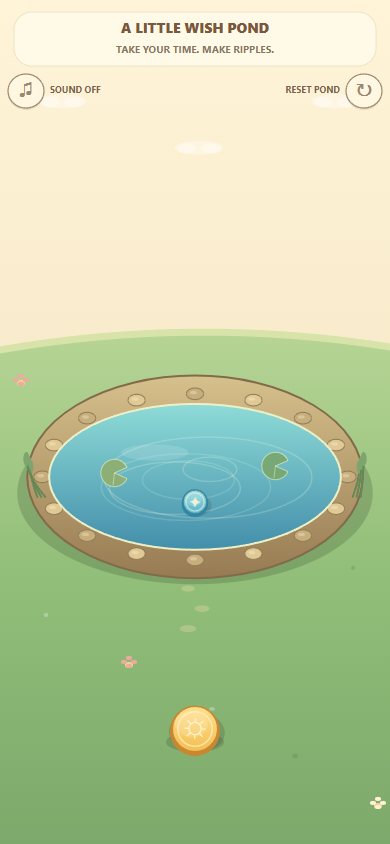

# Little Wish Pond

A tiny, cozy coin-tossing toy for taking a breath and making a few ripples. There are no points to chase, timers to beat, or wrong ways to play—just colorful little tokens, a peaceful pond, and the satisfying arc of a well-aimed toss.

## Take a little pause

Pull back from the coin to choose a direction and a little strength, then let go to toss it into the water. Each coin that lands in the pond makes a splash and joins the gentle cluster of floating wishes. Miss the water? No worries—there's always another coin waiting.

The scene is drawn in a warm, handcrafted storybook style, with softly moving water, lily pads, and a quiet garden. Sound is optional, and the game is happy to keep going for as long as you'd like.

## How to play

- **Aim:** Drag backward from the coin. A small guide shows your direction and approximate strength.
- **Toss:** Release to send the coin on its arc toward the pond.
- **Sound:** Tap the music-note button to toggle gentle sounds.
- **Reset:** Tap the reset button to clear the floating coins and begin again.

Touch and mouse input are both supported. The layout adapts to portrait phones, landscape screens, and desktop.

## Play

Open [`index.html`](index.html) in a modern browser. The game is a single self-contained HTML file, with no installation, network access, or external dependencies required.
